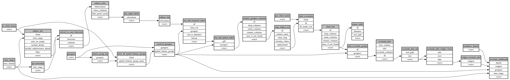

```
# AUTOGENERATED BY ECOSCOPE-WORKFLOWS; see fingerprint in README.md for details

```

```yaml
# fingerprint:
artifacts_sha256_basic: 091cbe76a09a284f585bf22913c317c111e1cc1e11805cde20bcae9daf73a2e2
artifacts_sha256_strict: 83d1b95b41693a90c51b9cb6432f65bb2827a2911c04082063935999ceddb9d1
installed_requirements:
- channel: https://repo.prefix.dev/ecoscope-workflows/
  name: ecoscope-platform
  version: {version: ==2.16.1}
- channel: conda-forge
  name: pydeck
  version: {version: ==0.9.2}
- channel: https://repo.prefix.dev/ecoscope-workflows-custom/
  name: subject-trajectory-covariate-labelling-tasks
  version: {version: ==0.3.4}
params_sha256: 6a94fe0bd7746237c7a32ce3ee5df5b411116d7ef76887b605295a69282e3bb2
spec_sha256: 8d08dd06c0c55f5989290352e22502730649df8b3dc9578d1dbf02f3ac6f06c9

```

# ecoscope-workflows-subject-trajectory-covariate-labeling-workflow


